<!-- _class: lead -->
<!-- _paginate: false -->

# そのコード、
# 本当に速いですか？

### 〜 アルゴリズムを学ぶと「なんか遅そう」に気づける 〜

**massan**

---

## 自己紹介

- **massan** / RUNTEQ 59期 → 現在は講師・エンジニア
- 約10年の引きこもりニート → 2024年7月 RUNTEQ入学
- ラジオイベント「オールナイトランテック」メインパーソナリティ
- X : @massan_E

---

## 今日のゴール

1. 「**なんか遅そう**」に気づける感覚の正体を知る
2. 気づいたら、**仮説を立てて、実際に測って、直す**を体験する
3. その感覚を育てるために、**アルゴリズムを勉強しよう**と思って帰る

今日は半分以上、手を動かす時間です。

---

## きっかけ

自分のアプリで「コメントをランダムに1件出す」機能を作っていた時のこと。

AIが出してきたコードを見て、こう思いました。

> 「これ、**なんか遅そう**やな・・・」

```ruby
Board.find(2).comments.sample
```

---

## なぜ気づけたのか

当時の僕は、**アルゴリズムの勉強**をしていました。

このコードは「**全部取ってきてから1つ選ぶ**」。件数が増えたら、そのぶん重くなるはず。

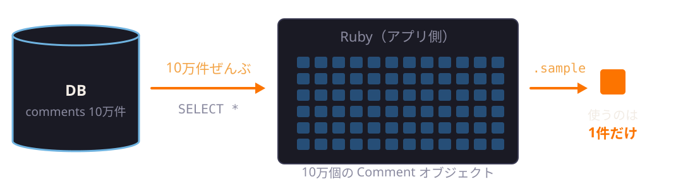

**感覚で「遅そう」と思えた**のは、毎日アルゴリズムに触れていたからです。

---

## そこからやったこと

1. 「遅そう」と**疑問を持つ**
2. 「こう書けば速いはず」と**仮説を立てる**
3. 10万件のデータを作って**実際に測る**
4. 「なぜ速いのか」を**調べる**
5. **理解して、改善する**

この流れをまとめたのが、2024年に書いたQiita記事です。

---

<!-- _class: lead -->

# 今日は、この流れを
# みんなで体験します

---

<!-- _class: lead -->

# 第1部
# 計算量ってなんやねん

---

## 問題：1〜100を全部足すと？

真面目にやるとこうなります。

```text
1 + 2 = 3
3 + 3 = 6
6 + 4 = 10
...
4950 + 100 = 5050
```

足し算は **99回**。

---

## 実は、こうできる

```text
  1 +  2 +  3 + ... +  99 + 100
100 + 99 + 98 + ... +   2 +   1
---------------------------------
101 + 101 + 101 + ... + 101 + 101   ← 101 が 100 個
```

上下で足すと、101 が 100 個。半分にすればいいので

# 101 × 50 = 5050

計算は **2回** で終わります。

---

## 100 なら大差ない。でも

| 足す数 | 1つずつ足す | 公式 |
| --- | --- | --- |
| 100 | 99回 | 2回 |
| 1万 | 9,999回 | 2回 |
| 1000万 | 9,999,999回 | 2回 |

**数が増えるほど、差がどんどん開く。**

この「データが増えたときに、計算回数がどう増えるか」を **計算量** といいます。

---

## Rubyで測ってみると（n = 1000万）

```ruby
# 1つずつ足す
total = 0
(1..n).each { |i| total += i }

# 公式
n * (n + 1) / 2
```

| 書き方 | 実行時間 |
| --- | --- |
| 1つずつ足す | 263 ms |
| 公式 | **0.0016 ms**（約16万倍速い） |

---

<!-- _class: small -->

## 計算量の書き方：ビッグオー記法

「データが **n** 件のとき、だいたい何回計算するか」を表します。英語では **Big O notation**、数学では **ランダウの記号** と呼ばれます。

| 書き方（読み方） | データが10倍になると | 代表的なアルゴリズム |
| --- | --- | --- |
| O(1)（オーダー いち） | **変わらない** | 和の公式、配列の添字アクセス |
| O(log n)（オーダー ログエヌ） | **ちょっと増える** | 二分探索 |
| O(n)（オーダー エヌ） | 10倍 | 線形探索（1つずつ全部見る） |
| O(n log n)（オーダー エヌログエヌ） | 10倍ちょっと | マージソート |
| O(n²)（オーダー エヌじじょう） | 100倍 | バブルソート（二重ループ） |

細かい定義は覚えなくて大丈夫です。**「10倍で何倍？」** だけ持って帰ってください。

---

## グラフで見ると

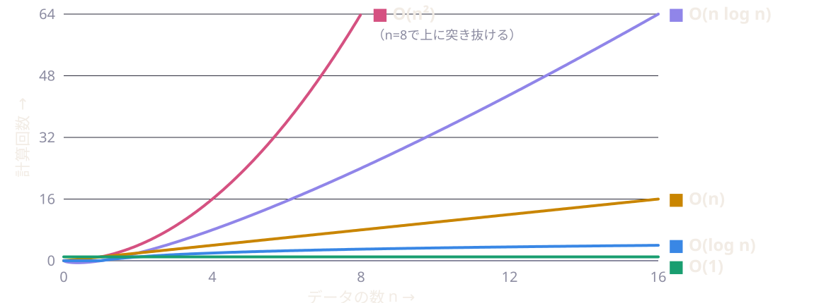

n = 1000 なら、O(log n) は約10回、O(n) は1000回、O(n²) は **100万回**。

---

## O(log n) の代表：二分探索（Binary Search）

**並んだデータ**から 37 を探す。真ん中と比べて、半分を捨てるを繰り返す。

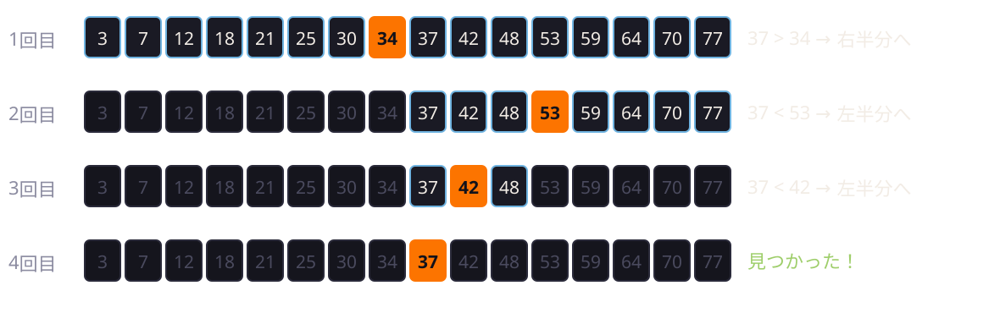

1回ごとに候補が **半分**。16件なら4回、**100万件でも約20回**で見つかる。

---

## 二分探索は、身近なところにもある

- **辞書を引く**：真ん中を開いて「ま」→ もっと前やな → 前半の真ん中を開く…
- **DBのインデックス**：中身は **B木（B-tree）** という木構造。
  データを並べた状態で持っていて、二分探索と同じ考え方で **一気に範囲を絞る** ので O(log n)

| データ数 n | 線形探索 O(n) | 二分探索 O(log n) |
| --- | --- | --- |
| 1,000 | 最大 1,000回 | 約10回 |
| 100万 | 最大 100万回 | 約20回 |
| 10億 | 最大 10億回 | 約30回 |

**データが1000倍になっても、10回増えるだけ。**

---

<!-- _class: lead -->

# 第2部
# ActiveRecordは
# 何でもやってくれるわけじゃない

---

## そもそも ActiveRecord ってなに？

Railsに入っている、**RubyとDBの間の翻訳係**です。

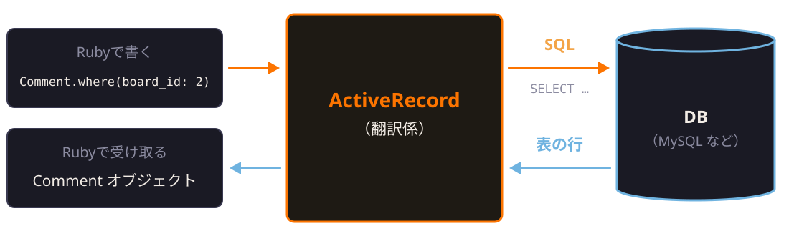

- DBは **SQL** という言葉しかわからない → Rubyで書いたものを **SQLに翻訳** して渡す
- DBから返ってきた **表の1行** を、Rubyの **オブジェクト1個** に変えて返す

こういう仕組みを **ORM（Object-Relational Mapping）** といいます。

---

## テーブルとクラスの対応

| DB側 | Ruby側（ActiveRecord） |
| --- | --- |
| `comments` テーブル | `Comment` クラス |
| 表の1行 | `Comment` オブジェクト1個 |
| `body` カラム | `comment.body` |

```ruby
comment = Comment.find(1)   # SELECT * FROM comments WHERE id = 1 LIMIT 1 が飛ぶ
comment.body                # => そのコメントの本文
```

SQLを書かなくても、**Rubyのメソッドを呼ぶだけ**でDBを使える。

---

## 翻訳の前に：「構文木」というもの

文やプログラムの **組み立て（構造）を木の形で表したもの** を **構文木** といいます。

```sql
SELECT * FROM comments WHERE board_id = 2 ORDER BY id LIMIT 1
```

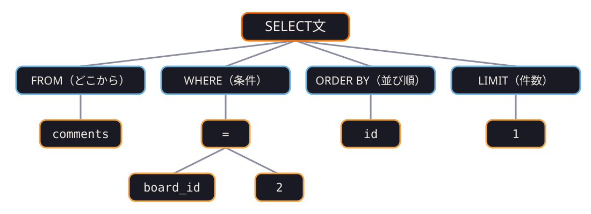

---

## 抽象構文木（AST：Abstract Syntax Tree）

さっきの木のように、カッコやキーワードの綴り、**書いた順番など意味に関係ない情報を省いて**、
**意味の骨組みだけ**を残した構文木を **抽象構文木** といいます。

- 木の **どの枝に何が入るか** が決まっている
- だから、木から文に戻すと **いつも正しい順番** の文になる

ActiveRecordの中では **Arel** というライブラリが、SQLの抽象構文木を扱っています。
（Arelの説明文：*"Arel is a SQL AST manager for Ruby"*）

---

## ActiveRecordは「注文票」を書いている

つまり、ActiveRecordがやっているのは **決まった欄がある注文票** を埋めることです。

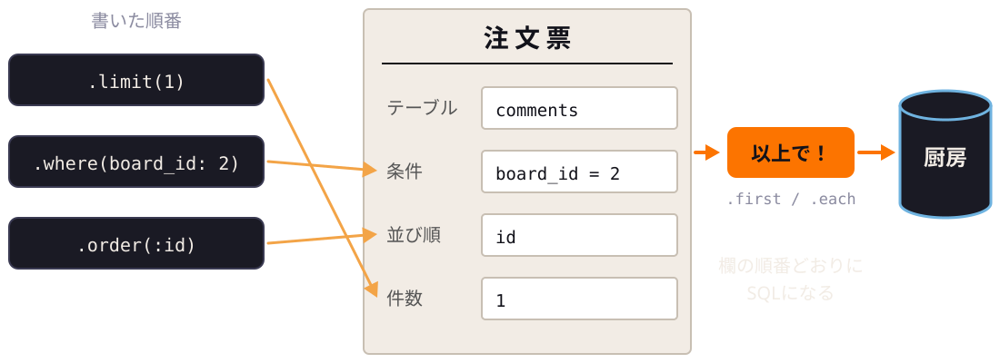

- `where` / `order` / `limit` … 欄に**書き込んでいるだけ**（まだDBには行かない）
- `first` / `each` … 「以上で！」で、欄から木を組み立て → **SQLにしてDBへ**

---

## 書く順番がバラバラでも大丈夫

```ruby
Comment.limit(1).order(:id).where(board_id: 2).first
Comment.where(board_id: 2).order(:id).limit(1).first
```

どちらも、出てくるSQLは同じです。

```sql
SELECT * FROM comments WHERE board_id = 2 ORDER BY id LIMIT 1
```

欄（＝木の枝）の場所が決まっているので、**書いた順番ではなく、欄の順番** でSQLになります。

---

## でも、翻訳できないものもある

```ruby
Board.find(2).comments.sample
```

`sample` は **Rubyの配列のメソッド**。注文票に `sample` の欄はないので、SQLに翻訳できません。

> 「とりあえず**全部持ってきて**。あとで自分で選ぶから」

```sql
SELECT * FROM comments WHERE board_id = 2   -- 10万件ぜんぶ
```


---

## 全部持ってくると、何が重いのか

10万件それぞれを、Rubyの `Comment` オブジェクトに変換しています。


**取ってくるより、オブジェクトにする方が重い。**

> **ActiveRecordが翻訳してくれるのは、SQLに翻訳できるメソッドだけ**

---

<!-- _class: lead -->

# 第3部
# ハンズオン

---

## 準備できてますか？

```bash
git clone https://github.com/massan-E/sql-algorithm-handson.git
cd sql-algorithm-handson
./setup.sh
```

「セットアップが完了しました！」と出ればOK。

データは **コメント100万件**（うち掲示板2に10万件、掲示板1は0件）。

---

## 使うコマンドは3つだけ

| コマンド | やること |
| --- | --- |
| `bin/run 01` | 計測する（`--sql` で発行されたSQLも見られる） |
| `bin/try 01` | 自分のコードを書くファイルを作る |
| `bin/console` | ActiveRecordを自由に試す |

`bin/try` を実行するたびに `01.rb`、`02.rb`…と**新しいファイルが増えます**。
前のファイルは**上書きされずに残る**ので、試した履歴がそのまま残ります。

---

## 進め方

1. **測る**：まず遅い書き方（baseline）を `bin/run` で測る
2. **考える**：ファイル先頭の「仮説」欄に、どう直すかとその理由を書く
3. **書く**：`solve` メソッドを書き換える
4. **測る**：もう一度 `bin/run`

結果が **NG** のものは、速くても答えが間違っています。理由が表の下に出ます。

**秒数は人によって違います。** 見るのは「baseline の何倍か」です。

---

## ハンズオン1：未読コメントを数える

```ruby
def solve(board_id)
  Board.find(board_id).comments.select { |comment| comment.is_read == false }.size
end
```

掲示板についたコメントのうち、**未読のものの件数**を返してください。

- `bin/run 01 --sql` で、何を取ってきているか見てみよう
- 「数えるだけ」なのに、何を取ってきている？

# ⏱ 10分

---

## ハンズオン1：解説

| 書き方 | 実行時間 | baseline比 |
| --- | --- | --- |
| baseline：`select { }` で絞って `size` | 876 ms | x1.0 |
| `where(is_read: false).length` | 212 ms | x4.1 |
| `where(is_read: false).count` | **56 ms** | **x15.5** |

- `select { }`（ブロック付き）は **Ruby側** で絞り込む → 全件取ってくる
- `length` は **全件取ってきてから** 数える
- `count` は `SELECT COUNT(*)` → **数えるところまでDBがやる**

---

## どこで数えているか

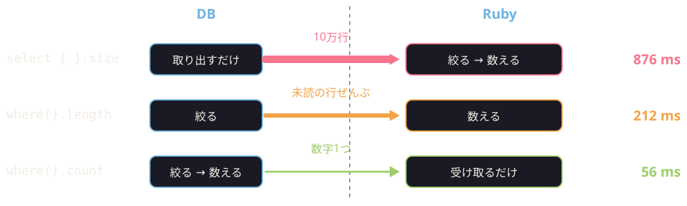

**DBからRubyに運ぶ量が減るほど、速くなる。**

---

## もう一歩：インデックスを足すと

```ruby
add_index :comments, [:board_id, :is_read]
```

| | 実行時間 |
| --- | --- |
| `count`（今のインデックス） | 60.6 ms |
| `count`（複合インデックスを追加） | **4.6 ms** |

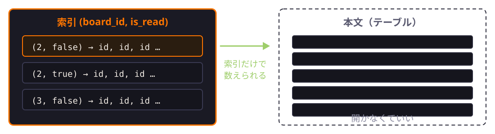

本の **索引だけ見て答えが出せる** ので、本文（テーブル）を開かずに済んでいます。

**SQLに任せたら終わり、ではない。**

---

## ハンズオン2：ランダムに1件取り出す

```ruby
def solve(board_id)
  Board.find(board_id).comments.sample
end
```

掲示板についたコメントから、**ランダムに1件**返してください。

- コメント0件の掲示板1では `nil` を返す（エラーにしない）
- 何回か実行して、毎回同じコメントにならない

# ⏱ 10分

---

## 記事の案1：全部取ってきて選ぶ

```ruby
Board.find(2).comments.sample
```

- 10万件ぜんぶをオブジェクトにしてから、1件選ぶ
- 計算量は **O(n)**。しかも1件1件が重い

**790 ms**

---

## 記事の案2：乱数ぶん飛ばして1件取る

```ruby
comments = Comment.where(board_id: 2)
comments.offset(rand(comments.count)).first
```

**37 ms**（ただし最遅は **93 ms**）

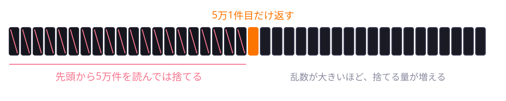

`OFFSET 50000` は、DBが **先頭から5万件を読んでは捨てる**。これも **O(n)**。

---

## 記事の案3：idだけ集めて選ぶ（記事の最終版）

```ruby
random_comment_id = Comment.where(board_id: 2).pluck(:id).sample
random_comment_id ? Comment.find(random_comment_id) : nil
```

**26 ms**（baselineの約30倍）

- `pluck` は **オブジェクトを作らない**
- `board_id` のインデックスには `id` も入っているので、**索引だけで答えが出る**

当時の僕は「やっとよさそうな記述が見つかりましたね！」と書いていました。

---

## でも、2年後に疑ってみた

このイベントを作るにあたって、**1000万件**で測り直しました。

| 書き方 | 100万件 | 1000万件 |
| --- | --- | --- |
| 案1 `sample` | 790 ms | 11.5 秒 |
| 案2 `offset` | 37 ms | 852 ms |
| 案3 `pluck(:id)` | 26 ms | **277 ms** |

案3も、id を **全部** 集めている。つまり **O(n)** のままでした。

---

## 別解：idの範囲から乱数を作る

```ruby
comments = Comment.where(board_id: board_id)
min_id, max_id = comments.pick(Arel.sql("MIN(id)"), Arel.sql("MAX(id)"))
return nil unless min_id

comments.where("id >= ?", rand(min_id..max_id)).order(:id).first
```

「乱数以上の id で、一番小さいもの」を **インデックスで探すだけ**。二分探索と同じ考え方の **O(log n)**。

| 100万件 | 1000万件 |
| --- | --- |
| **0.73 ms** | **0.59 ms** |

---

## 別解のイメージ

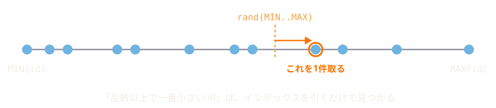

全部を集めない。**数直線の上に乱数を落として、その右隣を拾う** だけ。

---

## ただし、弱点もある

id の間に大きな抜けがあると、**抜けの直後が選ばれやすい**。

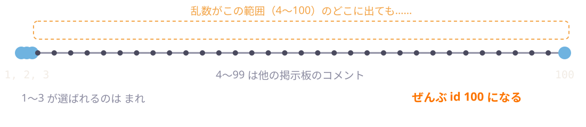

- 完全に均等なランダムが必要？
- だいたいランダムで、速ければいい？

**正解は1つじゃない。何を優先するかで選ぶ。**

---

## 全部並べると

<!-- _class: small -->

| 書き方 | 計算量 | 100万件 | 1000万件 |
| --- | --- | --- | --- |
| 案1 `sample` | O(n)（しかも重い） | 790 ms | 11.5 秒 |
| 案2 `offset` | O(n) | 37 ms | 852 ms |
| 案3 `pluck(:id)` | O(n) | 26 ms | 277 ms |
| `ORDER BY RAND()` | O(n)（全件に乱数を振る） | 86 ms | 2.4 秒 |
| **idの範囲から乱数** | **O(log n)** | **0.73 ms** | **0.59 ms** |

**データが10倍になったとき、どれだけ増えるか**を見てください。

---

<!-- _class: lead -->

# まとめ

---

## 今日やったこと

> **なんか遅そう** → **仮説を立てる** → **測る** → **なぜ？を調べる** → **直す**
> → 一度決めた答えも、**また疑う**（最初に戻る）

- ActiveRecordもAIも、**何でもやってくれるわけじゃない**
- だから**中身を知って**、**実際に測る**
- 一度決めた答えも、データが増えたら**また疑う**

---

## 「なんか遅そう」の正体

**計算量の感覚** です。

- 「全部取ってきてる」→ O(n) やな
- 「ループの中でまたループしてる」→ O(n²) やな
- 「インデックスで探してる」→ O(log n) やな

この感覚は、**アルゴリズムを勉強すると育ちます。**

AIがコードを書いてくれる時代だからこそ、
**出てきたコードを疑える目**が武器になります。

---

<!-- _class: tiny -->

## 気になったら調べてみよう：探す・並べ替える

| 名前 | 計算量 | ひとことで |
| --- | --- | --- |
| 線形探索（Linear Search） | O(n) | 先頭から1つずつ順番に調べる |
| 二分探索（Binary Search） | O(log n) | 並んだデータの真ん中と比べて、半分ずつ絞る |
| ハッシュテーブル（Hash Table） | 平均 O(1) | キーから保存場所を計算して一発で取り出す（Rubyの `Hash`） |
| バブルソート（Bubble Sort） | O(n²) | 隣どうしを比べて入れ替える、を繰り返す |
| 選択ソート（Selection Sort） | O(n²) | 一番小さいものを探して先頭に置く、を繰り返す |
| 挿入ソート（Insertion Sort） | O(n²) | トランプの手札のように、正しい位置に差し込む |
| マージソート（Merge Sort） | O(n log n) | 半分に分けて並べてから、きれいに合体させる |
| クイックソート（Quick Sort） | 平均 O(n log n) | 基準より小さい・大きいに分ける、を繰り返す（最悪 O(n²)） |
| ヒープソート（Heap Sort） | O(n log n) | 「一番大きいものがすぐ取れる木」を使って並べる |

---

<!-- _class: tiny -->

## 気になったら調べてみよう：その他の有名どころ

| 名前 | 計算量 | ひとことで |
| --- | --- | --- |
| 幅優先探索（BFS） | O(V + E) | 近いところから順に広げて探す。迷路の最短手数 |
| 深さ優先探索（DFS） | O(V + E) | 行けるところまで進んで、行き止まりで戻る |
| ダイクストラ法（Dijkstra） | O((V + E) log V) | 道に距離があるときの最短経路。カーナビの考え方 |
| 動的計画法（DP） | 問題による | 途中の答えをメモして使い回す |
| ユークリッドの互除法 | O(log n) | 割り算の余りを繰り返して、最大公約数を求める |
| B木（B-tree） | O(log n) | DBのインデックスの中身。並んだデータを木で持つ |

V = 点（場所）の数、E = 線（道）の数。
**名前で検索すると、図解つきの解説がたくさん出てきます。**

---

## 明日からできること

- `bin/run` みたいに、**2つの書き方を並べて測る**癖をつける
- Railsのログに出る **SQLと実行時間** を眺める
- AtCoder などで **アルゴリズムの問題を解いてみる**
- AIが出したコードに、**「これデータ10倍になったらどうなる？」** と聞く

---

<!-- _class: lead -->

## 時間が余った人は

## 追加問題（お題03・04）もどうぞ！

ご参加ありがとうございました！
